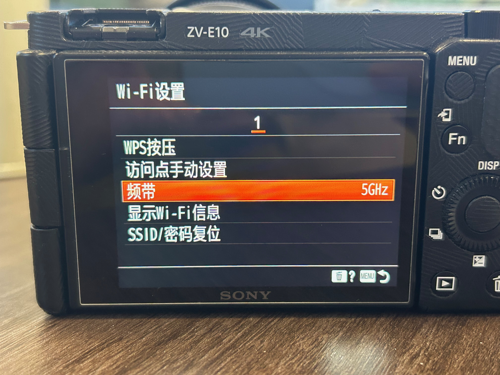

# ZV-E10 5 GHz Wi-Fi Unlock

**简体中文** | [English](README.md)

## 你知道吗？

ZV-E10 与第一代 A7C 使用相同的 Murata Type 1DR 无线模块和 Broadcom BCM4339 芯片。而且固件里面已经有索尼原生的 2.4/5 GHz 频带菜单，只是被索尼隐藏了。详见[技术说明](docs/technical.zh-CN.md)。

本项目解锁 Sony ZV-E10 第一代的原生 5 GHz Wi-Fi，改善无线传图和远程连接体验。

**已在 Sony ZV-E10 第一代的 2.02 和 2.03 固件上实机验证原生频段菜单解锁。**



## 修改内容

只需修改 **`CautionConfig.so` 的一个字节和三个 Backup 属性**：

| 目标 | 修改和作用 |
| --- | --- |
| `/usr/lib/CautionConfig.so` 文件偏移 `0xD778E4` | `20` → `1B`，选择原生 TypeNB Wi-Fi 菜单 |
| Backup `0x01071C54` | `01`，启用频带菜单 |
| Backup `0x00A5000B` | `02`，热点配置 XR/76 |
| Backup `0x00A5000C` | 十六进制 `16` = **十进制 22**，路由器连接配置 XR/143 |

上表为中国大陆配置。通过 USB-C 数据线连接相机与电脑即可完成修改，无须 fastboot 安装。详细步骤见[安装说明](docs/install.zh-CN.md)。

支持固件 **2.02（`30110_05.2025031501`）** 和 **2.03（`30110_06.2026060501`）**；2.03 使用 toolkit 的 Jiritsu 后端。

**修改菜单库和设置后，还需完成[暖启动镜像（WBI）检查与处理](docs/wbi.zh-CN.md)，再重启验收，才算完成安装。** 已处理且菜单正常的相机无需重复操作。

## 功能

- **相机热点**：可在原生菜单中选择 2.4 GHz 或 5 GHz，用于手机传图等直连功能。参见 Sony A7C 官方[频带设置说明](https://helpguide.sony.net/ilc/2020/v1/en/contents/TP1000156044.html)。
- **连接路由器**：支持连接 2.4 GHz 或 5 GHz 路由器，用于远程拍摄等功能。连接方法参见 A7C 官方[访问点设置](https://helpguide.sony.net/ilc/2020/v1/en/contents/TP1000115299.html)。同名、相同加密方式的双频访问点，列表会显示信号较强的访问点，见[官方频带说明](https://helpguide.sony.net/ilc/2020/v1/en/contents/TP1000156044.html)。

中国大陆配置下，5 GHz 热点传图、路由器连接和经路由器远程拍摄已实测。详见[实测记录](docs/evidence.zh-CN.md)。

## 安装前备份

建议先用 [zv-e10-toolkit](https://github.com/dino2048/zv-e10-toolkit) 对本机 eMMC 用户区和 B0/B1 各读取两遍，校验保存文件哈希并比较结果。备份与恢复准备见[安装说明](docs/install.zh-CN.md)。

## 用 AI Agent 安装

克隆仓库，在 Codex 或 Claude Code 中打开目录：

```sh
git clone https://github.com/dino2048/ZV-E10-5GHz-WiFi-Unlock.git
cd ZV-E10-5GHz-WiFi-Unlock
```

建议提示词：

> 请先读 AGENTS.md 和 docs/install.zh-CN.md，帮我核对兼容性、备份相机，再协助安装。写入前请让我确认实际使用国家或地区及修改范围，保存本机原始值，并核对恢复方法。Windows 上请按 PowerShell 准备步骤操作。

安装工具复用 [zv-e10-toolkit](https://github.com/dino2048/zv-e10-toolkit)，由 AI Agent 按[安装说明](docs/install.zh-CN.md)协助准备环境并操作。
Windows 2.03 已有社区完整安装及手机连接 5 GHz 热点的成功报告。按[PowerShell 准备步骤](docs/install.zh-CN.md#windows-主机准备powershell)完成备份、安装与验收，记录见[验证说明](docs/evidence.zh-CN.md)。

[安装步骤](docs/install.zh-CN.md) · [Agent 指引](AGENTS.md) · [验收和恢复](docs/recovery.zh-CN.md)

## 地区与兼容性

不同国家和地区对无线频段、发射功率等有不同监管要求，请根据相机实际使用地选择地区配置。

下表列出 A7C 原厂地区配置及对应的 XR 修订。**目前仅中国大陆 B=2/C=22 在 ZV-E10 上完成功能实测。**

| A7C 原厂地区标签 | B / C（十进制） | XR 修订（热点 / 路由器） | ZV-E10 状态 |
| --- | --- | --- | --- |
| 中国大陆 CN1/CN2 | 2 / 22 | 76 / 143 | 功能已实测 |
| 日本 J1 | 3 / 23 | 77 / 144 | 未测试 |
| 欧洲 CEC | 14 / 23 | 88 / 144 | 未测试 |
| 北美 UC2 | 18 / 25 | 139 / 146 | 未测试 |
| KR2 | 14 / 23 | 88 / 144 | 社区报告：2.03 安装、菜单、热点 XR/88 |
| AP2 | 14 / 23 | 88 / 144 | 未测试 |
| IN5 | 14 / 23 | 88 / 144 | 未测试 |
| JE3 | 20 / 22 | 141 / 143 | 未测试 |
| E38 | 17 / 24 | 138 / 145 | 未测试 |
| ALLLANG | 14 / 23 | 88 / 144 | 未测试 |
| AF1 | 9 / 9 | 83 / 83 | 未测试；原厂频带菜单关闭 |

完整对照见[地区配置说明](docs/regions.zh-CN.md)。

Linux 2.03 与 KR2/CEC 类配置还有[社区单机成功报告](https://github.com/dino2048/ZV-E10-5GHz-WiFi-Unlock/issues/2)，覆盖安装、菜单和热点配置读取；具体范围见[验证说明](docs/evidence.zh-CN.md)。

## 技术资料与致谢

[技术原理及逆向经验](docs/technical.zh-CN.md) · [实测记录与来源](docs/evidence.zh-CN.md) · [验证范围](docs/release.zh-CN.md)

感谢 [Sony-PMCA-RE](https://github.com/ma1co/Sony-PMCA-RE) 提供服务协议实现，及 [zv-e10-toolkit](https://github.com/dino2048/zv-e10-toolkit) 提供备份、服务与恢复工具。本项目原创代码及文档采用 MIT，第三方声明保留在 [licenses/](licenses/)。仓库不包含 Sony 固件、个人备份、设备密钥、MAC 地址或 Wi-Fi 凭据。

## 免责声明

本项目非 Sony 官方，未获 Sony 背书。固件修改及无线解锁存在设备故障、数据丢失、保修和监管风险。采用 A7C 原厂配置，不能证明修改后的 ZV-E10 获得当地无线型号核准。用户自行负责遵守实际使用地的规定。
